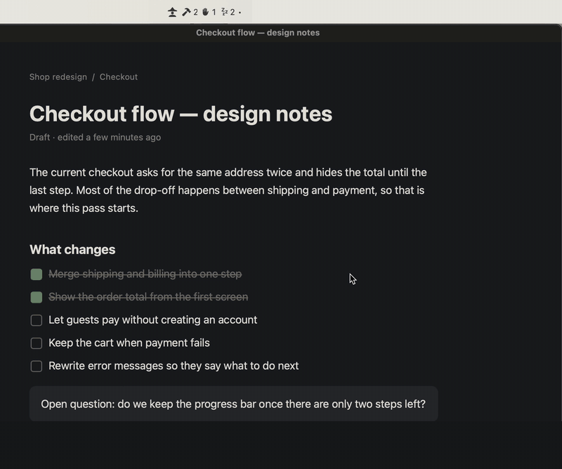
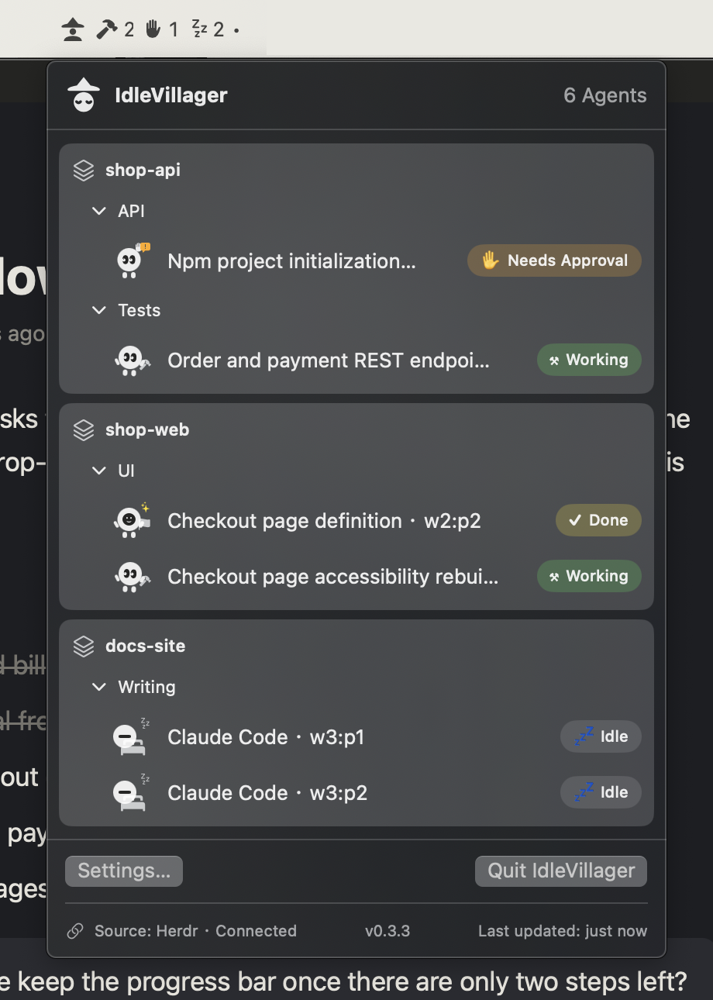

<p align="center">English | <a href="README.zh-TW.md">繁體中文</a></p>

# IdleVillager

<p align="center"><strong>Your agents are waiting. You're in another window.</strong><br>
IdleVillager puts the state of every AI agent in Herdr on the macOS menu bar, where you can see it from any app.</p>

<p align="center"></p>

I run several agents at once in Herdr. Once they have their orders, I switch to another window and get on with something else.

The trouble is that once another window covers Herdr, I can't see what's going on in there. By the time I remember to switch back, one agent has been stopped for who knows how long, waiting for me to approve something. A few others finished a while ago and nobody noticed.

If you've played *Age of Empires*, you know this scene: a villager finishes chopping a tree and just stands there, and you're too busy with a battle to notice. Luckily there's an idle villager button in the corner of the screen. It tells you how many villagers have nothing to do, and pressing it jumps the camera straight to one of them.

IdleVillager moves that button to the macOS menu bar. The menu bar stays put whichever app you're in, so your agents are always one glance away.

## How it works

**Check the counts.** The menu bar shows a few small icons with numbers: how many agents are working, how many are waiting for you, how many are idle. When an agent starts waiting for approval, the menu bar lights up for about three seconds. No sound, no notification.

**See who it is.** Click to open a list grouped by Workspace, Tab, and Pane, where the agents that need you come first. Each agent is a little villager: the working ones swing a hammer, the waiting ones raise a hand, the idle ones lie down and sleep.

**Click to go back.** Click any row and IdleVillager switches back to Herdr and jumps to that pane. No more flipping through tabs one by one.

<p align="center"></p>

https://github.com/user-attachments/assets/998ebc78-3a11-4942-b151-3117eeec1519

## A few things I insist on

- There are six states: Working, Needs Approval, Done, Idle, Error, Unknown. Done and Idle are counted separately.
- If IdleVillager can't tell, it says Unknown. An agent that has been quiet for a while isn't necessarily idle, and I'd rather not guess.
- When Herdr disconnects, it says disconnected. It won't show 0 agents and let you think everyone has gone home.
- Everything runs on your Mac. No account, no cloud. It reads session state only, never the conversation.
- Every state has both an icon and a number, so you never have to rely on color.
- The interface comes in English and Traditional Chinese (no Simplified Chinese). English is the default. To switch, open Settings and change **Language** in the Appearance section; it takes effect immediately.

## Install

IdleVillager is distributed as a Herdr plugin. Installing it builds the app from source on your own Mac, so you don't have to deal with macOS blocking unsigned apps.

Requirements:

- macOS 14 or later.
- Herdr 0.9.5 or later, with the Herdr TUI in use.
- Xcode Command Line Tools (provides the Swift 6 compiler). If you don't have them yet, run `xcode-select --install`.

Install:

```sh
herdr plugin install Lewsiafat/IdleVillager
```

Herdr first shows you what the plugin contains and asks for confirmation, then builds the app, which takes about one to two minutes. When the build finishes, IdleVillager opens automatically, and it also opens every time the Herdr server starts. To reopen it after you've quit it, run:

```sh
herdr plugin action invoke launch --plugin idlevillager
```

Update and uninstall:

```sh
herdr plugin update idlevillager
herdr plugin uninstall idlevillager
```

An update rebuilds the app, then automatically quits the old version and opens the new one; it reopens the app even if you had quit it before updating. Uninstalling the plugin does not quit the running app; quit it from the menu bar popover with **Quit IdleVillager** (「結束 IdleVillager」 when the interface is Traditional Chinese). Herdr keeps the installed files when it removes a plugin, under `~/.config/herdr/plugins/github-installations/`.

If you can't see the icon in the menu bar after installing, the menu bar is usually out of space: MacBooks with a notch silently hide menu bar icons that don't fit. Hold ⌘ and drag other rarely used icons out of the menu bar to make room.

## What's new

[v0.3.3](https://github.com/Lewsiafat/IdleVillager/releases/tag/v0.3.3) (2026-11-14) fixes a crash: once the list had been opened, any agent changing state could take the whole app down and make it vanish from the menu bar. v0.3.2 was hit especially often, so update if you're still on it. Every version's changes are in [`CHANGELOG.md`](CHANGELOG.md).

## Trademarks

The name comes from the idle villager alert in *Age of Empires*. IdleVillager is not affiliated with or representing the game's publishers.

This repo does not ship third-party brand logos or other brand assets. Official Claude, Codex, and Gemini logos must be obtained separately, following each one's source, version, and terms of use. Where to put them is described in [`Sources/IdleVillagerApp/Resources/Brands/README.md`](Sources/IdleVillagerApp/Resources/Brands/README.md) (in Traditional Chinese). Without a logo, the character automatically falls back to the Generic villager.
