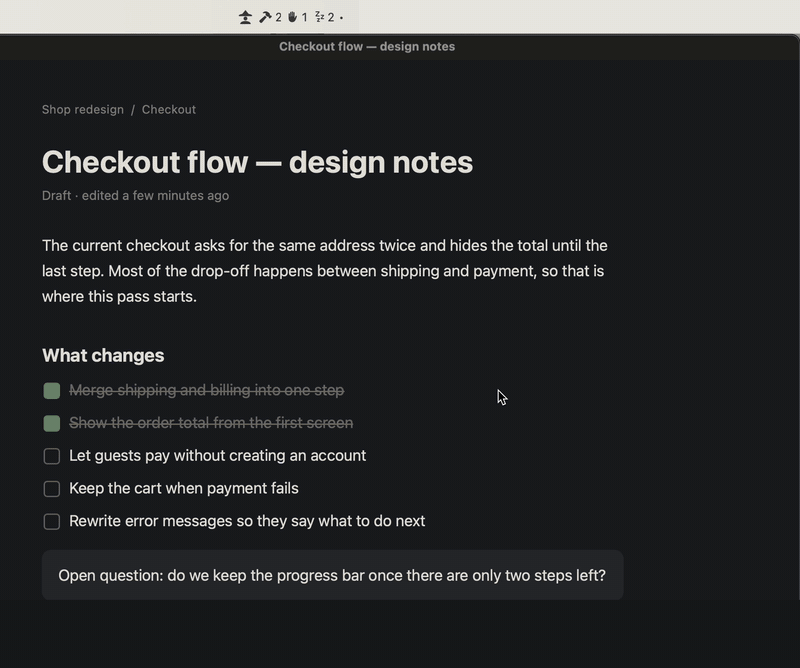
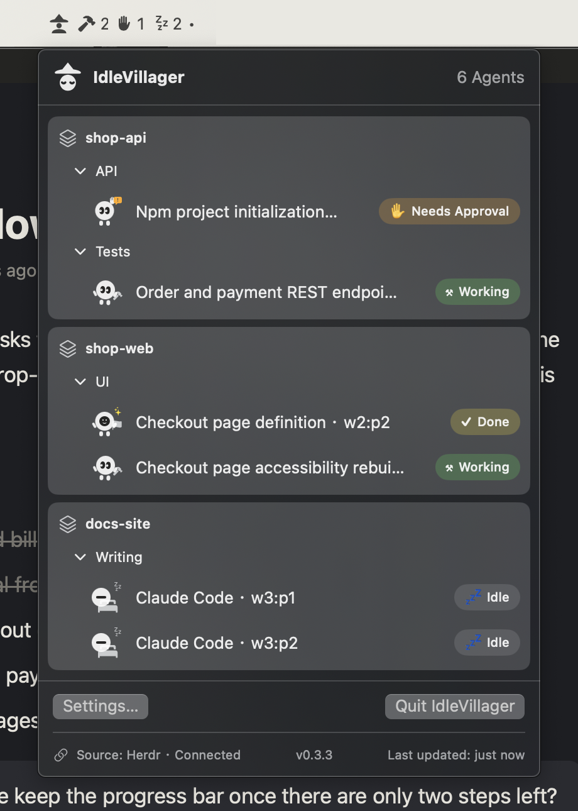

<p align="center"><a href="README.md">English</a> | 繁體中文</p>

# IdleVillager

<p align="center"><strong>Agent 在等你，而你在別的視窗。</strong><br>
把 Herdr 裡每個 AI Agent 的狀態放上 macOS 選單列，切到哪個 App 都看得到。</p>

<p align="center"></p>

我用 Herdr 同時跑好幾個 Agent。交代完工作，我就切去別的視窗忙其他事。

問題是 Herdr 一被別的視窗蓋住，裡面發生什麼事我就看不到了。等我想起來切回去，才發現有個 Agent 早就停下來等我核准，不知道等多久了。其他幾個做完了，也沒人理。

玩過《世紀帝國》的人應該很熟這個場面：村民砍完樹就站在原地發呆，你忙著打仗根本沒發現。還好畫面角落有一顆閒置村民按鈕，告訴你有幾個村民沒事做，按下去鏡頭就跳到他身上。

IdleVillager 把這顆按鈕搬到 macOS 選單列。選單列不管你切到哪個 App 都在，所以 Agent 的狀況隨時瞄得到。

## 用起來是這樣

**先看數量。** 選單列上是幾個小圖示配數字：幾個在工作、幾個在等你、幾個閒著。有 Agent 開始等你核准的時候，選單列會亮大約三秒，沒有音效，也不跳通知。

**再看是誰。** 點開來是一份清單，照 Workspace、Tab、Pane 分好，要你處理的排在前面。每個 Agent 是一個小村民：工作中的在敲榔頭，等你的舉著手，閒著的躺平睡覺。

**點一下回去。** 點清單裡任何一列，就會切回 Herdr 並跳到那個 pane，不用自己一個個 tab 翻。

<p align="center"></p>

https://github.com/user-attachments/assets/998ebc78-3a11-4942-b151-3117eeec1519

## 幾件我比較堅持的事

- 狀態分六種：Working、Needs Approval、Done、Idle、Error、Unknown。做完（Done）和閒置（Idle）分開算。
- 判斷不出來就寫 Unknown。Agent 很久沒輸出不代表它閒著，這種事我不想用猜的。
- Herdr 斷線就顯示斷線，不會顯示 0 個 Agent 讓你以為大家都收工了。
- 全部在你的電腦上跑，沒有帳號，沒有雲端。只讀 session 的狀態，不讀對話內容。
- 每個狀態都同時有圖示和數字，不用靠顏色分辨。
- 介面有英文和繁體中文（沒有簡體中文），預設是英文。要換的話打開設定視窗，在「Appearance」區段的「Language」選「繁體中文」，馬上生效。

## 安裝

IdleVillager 是一個 Herdr plugin。安裝時會在你的電腦上從原始碼建置 App，所以不用處理 macOS 擋未簽章 App 的問題。

你需要：

- macOS 14 以上。
- Herdr 0.9.5 以上，並且正在使用 Herdr TUI。
- Xcode Command Line Tools（提供 Swift 6 編譯器）。還沒裝的話，執行 `xcode-select --install`。

安裝：

```sh
herdr plugin install Lewsiafat/IdleVillager
```

Herdr 會先給你看 plugin 的內容並請你確認，接著建置 App，大約一到兩分鐘。建置完 IdleVillager 會自己打開，之後每次 Herdr server 啟動也會跟著打開。關掉之後想再開，執行：

```sh
herdr plugin action invoke launch --plugin idlevillager
```

更新與移除：

```sh
herdr plugin update idlevillager
herdr plugin uninstall idlevillager
```

更新會重新建置，完成後自動關掉舊版、打開新版；就算你更新前已經把 App 關了，更新完也會再打開。移除 plugin 不會關掉正在執行的 App，請從選單列清單底部的「結束 IdleVillager」關閉（英文介面是 Quit IdleVillager）。Herdr 移除 plugin 時會留下安裝檔案，位置在 `~/.config/herdr/plugins/github-installations/`。

裝好後在選單列找不到圖示，通常是位置不夠：有瀏海的 MacBook 會把放不下的選單列圖示藏起來，而且不會告訴你。按住 ⌘ 把不常用的圖示拖出選單列，騰出位置。

## 最近更新

[v0.3.3](https://github.com/Lewsiafat/IdleVillager/releases/tag/v0.3.3)（2026-11-14）修掉一個當機問題：清單打開過之後，只要有 Agent 的狀態改變，App 可能整個當掉並從選單列消失。v0.3.2 特別容易遇到，還在用的話建議更新。每一版改了什麼都記在 [`CHANGELOG.md`](CHANGELOG.md)。

## 商標

名稱來自《世紀帝國》的閒置村民提示。IdleVillager 不隸屬或代表遊戲官方。

本 repo 不附帶第三方品牌標誌或其他品牌素材。Claude、Codex、Gemini 的官方標誌需依各自的來源、版本及使用條款另行取得。放置位置見 [`Sources/IdleVillagerApp/Resources/Brands/README.md`](Sources/IdleVillagerApp/Resources/Brands/README.md)。沒有放入標誌時，角色會自動改用 Generic 小村民。
