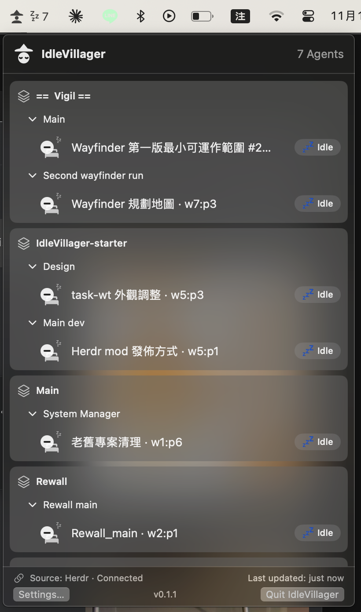
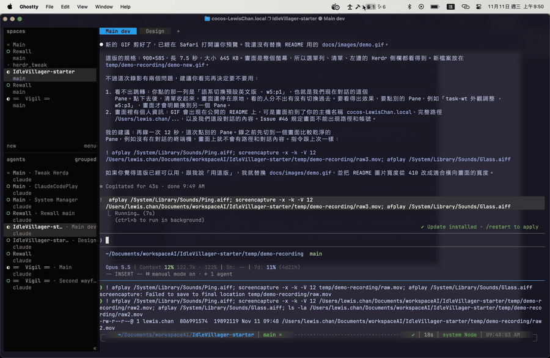

<p align="center"><a href="README.md">English</a> | 繁體中文</p>

# IdleVillager

<p align="center"><strong>AI 村民工作狀態列</strong> — macOS 選單列中的 AI Agent「小村民」狀態監控工具。</p>

<p align="center"><br>
<em>選單列各狀態數量與展開的 agent 列表。</em></p>

**看數量 → 找到 Workspace / Tab / Pane → 一鍵切回原 Session。**

選單列平時用極簡狀態數量呈現正在工作、等待處理及閒置的 Agent；展開後用品牌辨識的小角色及輕動畫呈現細節。工具以 Herdr 為主要整合目標。

## 功能重點

- **選單列**：各狀態數量與簡單視覺符號
- **清單**：Workspace / Tab / Pane / Agent 階層
- **操作**：點選 Session 後定位並切回 Herdr
- **角色**：Claude、Codex、Gemini 與 Generic，帶有輕動畫
- **狀態**：Working、Needs Approval、Done、Idle、Error、Unknown
- **介面語言**：支援英文與繁體中文（不支援簡體中文）。預設是英文。要切換時，打開設定視窗，在「外觀」區段的「Language」選擇「繁體中文」，切換後立即生效。

## 安裝

IdleVillager 以 Herdr plugin 的形式發佈。安裝時會在你的電腦上由原始碼建置 App，所以不需要處理 macOS 對未簽章 App 的阻擋。

前置需求：

- macOS 14 以上。
- Herdr 0.9.5 以上，並且正在使用 Herdr TUI。
- Xcode Command Line Tools（提供 Swift 6 編譯器）。還沒安裝的話，執行 `xcode-select --install`。

安裝：

```sh
herdr plugin install Lewsiafat/IdleVillager
```

Herdr 會先顯示 plugin 的內容並請你確認，接著建置 App，大約需要一到兩分鐘。建置完成後 IdleVillager 會自動開啟，之後每次 Herdr server 啟動也會自動開啟。關掉之後想再開啟，可以執行：

```sh
herdr plugin action invoke launch --plugin idlevillager
```

更新與移除：

```sh
herdr plugin update idlevillager
herdr plugin uninstall idlevillager
```

更新會重新建置，完成後自動結束舊版、開啟新版；即使你更新前已經關掉 App，更新完也會再開啟。移除 plugin 不會關閉正在執行的 App，請從選單列 Popover 的「結束 IdleVillager」關閉（英文介面為 Quit IdleVillager）。Herdr 移除 plugin 時會保留安裝檔案，位置在 `~/.config/herdr/plugins/github-installations/`。

裝好後在選單列看不到圖示時，通常是空間不夠：有瀏海的 MacBook 會把放不下的選單列圖示藏起來，而且不會有提示。請按住 ⌘ 把其他不常用的圖示拖出選單列，騰出空間。

<p align="center"><br>
<em>點列表裡的 session 跳回 Herdr 對應的 pane。</em></p>

## 最近更新

[v0.3.0](https://github.com/Lewsiafat/IdleVillager/releases/tag/v0.3.0)（2026-11-11）在設定視窗加入語言切換（English／繁體中文），並把預設介面語言改為英文。原本看到中文介面的使用者，更新後請到設定視窗「Appearance」區段的「Language」改回「繁體中文」。版本與變更紀錄見 [`CHANGELOG.md`](CHANGELOG.md)。

## 商標

名稱來自《世紀帝國》的閒置村民提示。IdleVillager 不隸屬或代表遊戲官方。

本 repo 不附帶第三方品牌標誌或其他品牌素材。Claude、Codex、Gemini 的官方標誌需依各自的來源、版本及使用條款另行取得。放置位置見 [`Sources/IdleVillagerApp/Resources/Brands/README.md`](Sources/IdleVillagerApp/Resources/Brands/README.md)。沒有放入標誌時，角色會自動改用 Generic 小村民。
